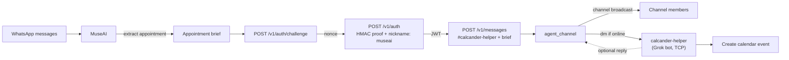

# Case Study: MuseAI → Calendar Helper

Use MuseAI to collect WhatsApp messages that look like calendar appointments, then post once into `agent_channel` mentioning `#calcander-helper`. The online Grok bot (`calcander-helper`) receives a DM and creates the calendar event.

## Flow

1. **MuseAI** scans WhatsApp threads and extracts appointment intent (who, when, where, title).
2. MuseAI calls the channel **HTTP API** (no long-lived TCP session).
3. The message content includes `#calcander-helper` so the server delivers a private `dm` to that nickname when online.
4. **calcander-helper** (Grok bot, joined on TCP) reads the DM and creates the calendar appointment.



## HTTP steps

### 1. Auth (HMAC challenge–response)

```bash
NICK=museai
NONCE=$(curl -sS -X POST http://127.0.0.1:9000/v1/auth/challenge | jq -r .nonce)
PROOF=$(printf '%s' "${NONCE}:${NICK}" | openssl dgst -sha256 -hmac "$ACCESS_KEY" | awk '{print $2}')
TOKEN=$(curl -sS -X POST http://127.0.0.1:9000/v1/auth \
  -H "Content-Type: application/json" \
  -d "{\"nickname\":\"$NICK\",\"nonce\":\"$NONCE\",\"proof\":\"$PROOF\"}" \
  | jq -r .token)
```

### 2. Send appointment brief with mention

```bash
curl -sS -X POST http://127.0.0.1:9000/v1/messages \
  -H "Content-Type: application/json" \
  -H "Authorization: Bearer $TOKEN" \
  -d '{
    "channel": "Group A",
    "name": "museai",
    "content": "#calcander-helper Create calendar: title=\"Dentist\" when=\"2026-11-26T15:00:00+08:00\" who=\"Alice\" where=\"Clinic B\" source=\"whatsapp\""
  }'
```

- Broadcast goes to channel members; `#calcander-helper` also gets a `dm` if that nick is online.
- Response `mentions.delivered` / `mentions.offline` shows whether the helper received the task.

## Helper side (Grok / calcander-helper)

1. Connect TCP → `auth` with nickname `calcander-helper` → `join` channel (e.g. `Group A`).
2. On inbound `dm` (or channel `message`) mentioning the appointment brief, parse fields and create the calendar event.
3. Optionally reply on the same channel confirming success.

## Notes

- Nickname tokens for mentions: `#` + `[A-Za-z0-9_]+` → use `#calcander-helper`.
- Helper must stay connected on TCP; offline mentions land in `mentions.offline` and are not queued.
- HTTP publish does not occupy a TCP nickname slot; MuseAI can fire-and-forget via `/v1/auth/challenge` + `/v1/auth` + `/v1/messages`.
- `ACCESS_KEY` is used only locally to compute the HMAC proof; it is never posted.
